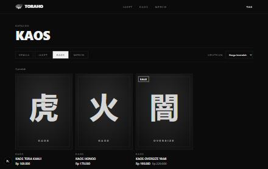
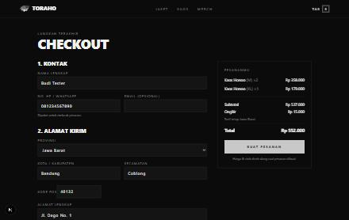
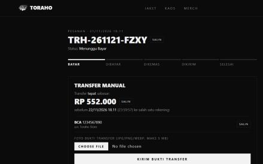
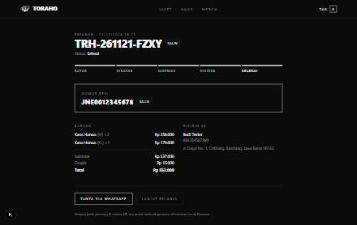
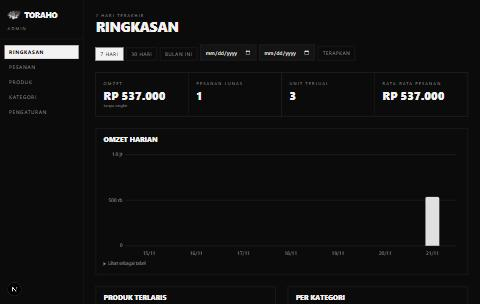
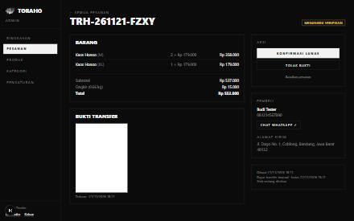
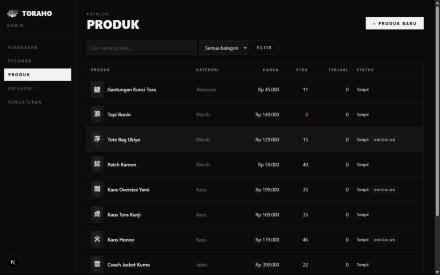
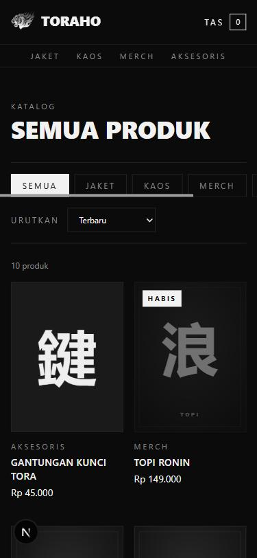

<p align="center">
  
</p>

<h1 align="center">Toraho 虎火</h1>

<p align="center"><b>Tora</b> (虎, harimau) × <b>Ho</b> (火, api)<br/>Toko online jaket, kaos, dan merchandise bernuansa Jepang. Monokrom, berani, dibuat untuk dipakai.</p>

---

Toraho adalah toko online full-stack yang dibuat untuk **dipakai sungguhan** dan sekaligus jadi **proyek portofolio**:

- Pembeli bisa checkout **tanpa akun** dan membayar lewat **QRIS / Virtual Account (Midtrans)** atau **transfer bank manual**.
- Pemilik toko punya **dashboard admin** untuk mengelola kategori, produk, harga, stok per ukuran, pesanan, dan laporan penjualan.


## Fitur

**Toko (pembeli)**
- Beranda bergaya *Yami* (闇): hitam pekat, logo putih, judul tebal kapital, dan aksen kanji vertikal.
- Katalog dengan filter kategori dan urutan harga. Produk habis diberi label **HABIS**.
- Detail produk: galeri foto, pilihan ukuran dengan stok per ukuran, dan peringatan "sisa N".
- Keranjang yang tersimpan di browser. Keranjang hanya menyimpan ID dan jumlah, sedangkan harga selalu diambil dari server.
- Checkout tanpa akun. Ongkir:
  - **Kurir (RajaOngkir/Komerce):** cari kelurahan/kecamatan/kode pos tujuan, pilih JNE/J&T/SiCepat dengan harga dan estimasi. Ongkir dihitung ulang di server saat pesanan dibuat.
  - **Tarif per provinsi:** dipakai saat RajaOngkir belum diatur, dan sebagai cadangan saat API gagal atau kuota habis.
- **Login pembeli dengan Google** (opsional): halaman **Akun saya** berisi riwayat pesanan, dan checkout terisi otomatis. Pesanan lama dengan email yang sama bisa dihubungkan setelah nomor HP dicocokkan.
- Pembayaran:
  - **Midtrans Snap**, hanya QRIS + VA (kartu kredit sengaja dimatikan karena biayanya tinggi).
  - **Transfer manual**: pembeli melihat rekening, nominal, dan hitung mundur, lalu mengunggah bukti yang **dicek admin**.
- Halaman status pesanan yang dibuka dengan **kode pesanan + nomor HP** (atau langsung lewat akun), berisi status, kurir, resi, dan tombol WhatsApp.

**Admin (`/admin`)**
- **Ringkasan**:
  - Omzet, jumlah pesanan, unit terjual, dan rata-rata per periode (7/30 hari, bulan ini, atau rentang sendiri).
  - Grafik harian.
  - Produk terlaris per produk, kategori, dan ukuran.
  - Stok menipis.
  - Kartu "perlu ditindak".
- **Pesanan**:
  - Tab per status, pencarian, dan filter tanggal.
  - Konfirmasi atau tolak bukti transfer (dengan alasan yang dilihat pembeli).
  - Kemas → kirim (dengan resi) → selesai.
  - Batal dengan pengembalian stok, dan tandai sudah refund.
- **Produk & Kategori**:
  - Tambah, ubah, dan sembunyikan.
  - Harga coret dan berat.
  - Varian/ukuran dengan stok dan SKU, plus tombol cepat S–XXL.
  - Unggah beberapa foto yang bisa diurutkan.
- **Pengaturan**: batas waktu bayar, rekening transfer, nomor WhatsApp, asal pengiriman dan status RajaOngkir, serta tarif ongkir per provinsi.

| Katalog | Checkout | Transfer manual | Status pesanan |
|---|---|---|---|
|  |  |  |  |

| Admin: Ringkasan | Admin: Pesanan | Admin: Produk | Mobile |
|---|---|---|---|
|  |  |  |  |

## Arsitektur

```
Next.js 15 (App Router, Server Actions)  ──  satu repo, satu deploy (Vercel)
│
├── src/app/(shop)/…          etalase publik
├── src/app/admin/…           panel admin (NextAuth, middleware + requireAdmin di setiap action)
├── src/app/api/midtrans/notification   webhook Midtrans (satu-satunya sumber status "lunas" online)
├── src/app/api/cron/expire             cron harian: pesanan lewat batas waktu → kedaluwarsa
│
├── src/features/*/service.ts logika bisnis (bebas UI, dites dengan Vitest + PostgreSQL)
├── src/lib/domain/*          aturan murni: state machine pesanan, total, kode pesanan, nomor HP
├── src/lib/payment/          PaymentProvider  → midtrans.ts      (adapter, bisa diganti)
├── src/lib/shipping/         ShippingRateProvider → province-rate.ts (tahap 2: API kurir)
└── src/lib/storage/          FileStorage → Vercel Blob (produksi) / public/uploads (dev)
     │
     └── PostgreSQL (Neon) via Prisma
```

### State machine pesanan

Semua perubahan status melewati satu tabel `ORDER_TRANSITIONS` (`src/lib/domain/order-status.ts`), baik dari webhook, admin, unggah bukti, maupun cron.

```
MENUNGGU_BAYAR ──unggah bukti──▶ MENUNGGU_VERIFIKASI ──admin konfirmasi──▶ DIBAYAR ─▶ DIKEMAS ─▶ DIKIRIM ─▶ SELESAI
      │  ▲                              │
      │  └────────admin tolak───────────┘
      ├──webhook lunas──────────────────────────────────────────────▶ DIBAYAR
      ├──nominal tidak cocok──▶ PERLU_TINDAKAN ──admin──▶ DIBAYAR / BATAL
      ├──lewat batas waktu──▶ KEDALUWARSA ──bayar telat──▶ DIBAYAR (stok ada) / PERLU_TINDAKAN (stok habis)
      └──batal──▶ BATAL   (juga dari DIBAYAR/DIKEMAS oleh admin; tidak dari DIKIRIM)
```

### Hal yang dijaga

| Risiko | Penjagaan |
|---|---|
| Dua pembeli membeli unit terakhir bersamaan | `UPDATE … WHERE stock >= qty` di dalam transaksi, sehingga hanya satu yang berhasil (dites paralel). |
| Pesanan "lunas" tanpa uang masuk | Status lunas online hanya dari webhook dengan tanda tangan SHA-512 terverifikasi. Nominal yang tidak cocok membuat pesanan berstatus `PERLU_TINDAKAN`. |
| Webhook terkirim dua kali | Tabel `PaymentEvent` unik per (transaksi, status), dan status tidak pernah mundur. |
| Stok dikembalikan dua kali | Flag `stockHeld` di pesanan, yang diubah secara atomik bersama pengembalian stok. |
| Harga dimanipulasi dari browser | Keranjang tidak menyimpan harga. Checkout membaca harga dari DB dan menyalinnya ke `OrderItem`. |
| Angka "terjual" salah | Hanya status Dibayar, Dikemas, Dikirim, dan Selesai, berdasarkan tanggal lunas. |

## Menjalankan secara lokal

Butuh: Node 20+, Docker (untuk PostgreSQL).

```bash
cp .env.example .env          # isi AUTH_SECRET (npx auth secret) & CRON_SECRET
docker compose up -d          # PostgreSQL di port 5434 (db toraho + toraho_test)
npm install
npx prisma migrate dev        # skema ke database lokal
npm run db:test:prepare       # skema ke database tes
npm run db:seed               # admin + pengaturan + produk contoh
npm run dev -- -p 3001        # http://localhost:3001  (admin: /admin)
```

- **Akun admin (lokal/demo):** `admin@toraho.test`, dengan kata sandi dari `SEED_ADMIN_PASSWORD` di `.env`.
- **Midtrans:** isi `MIDTRANS_SERVER_KEY` dengan Server Key **sandbox**. Tanpa key ini, opsi QRIS/VA dinonaktifkan dan hanya transfer manual yang bisa dipilih. Uji webhook lokal lewat tunnel: [docs/midtrans-sandbox.md](docs/midtrans-sandbox.md).
- **Login Google:** isi `AUTH_GOOGLE_ID` dan `AUTH_GOOGLE_SECRET`, lihat [docs/google-login.md](docs/google-login.md).
- **Ongkir kurir:** isi `RAJAONGKIR_API_KEY`, lalu atur asal pengiriman di admin. Cek respons asli dengan `npm run check:rajaongkir -- cibubur`. Lihat [docs/rajaongkir.md](docs/rajaongkir.md).
- **Tes:** `npm test`. Ada 216 tes untuk aturan domain, checkout (termasuk balapan stok dan hitung ulang ongkir), webhook, transfer manual, peran login, akun pembeli, klien RajaOngkir, admin, laporan, dan pengaturan.
- **Aset brand:** `npm run brand -- assets/logo-source.webp` membuat logo putih, mark, dan ikon dari logo sumber.
- **Koleksi 01:** 27 produk (kaos, hoodie, jaket zip, stiker, gantungan kunci, enamel pin, patch, tote) ada di `src/data/koleksi-01.ts`. `npm run db:seed:koleksi01` memasukkannya ke database (produk yang sudah ada tidak diubah, placeholder lama disembunyikan). Foto produk dibuat dari `design/koleksi-01/koleksi-01.html` dengan `npm run render:mockups` (butuh Chrome).

## Deploy

Kode yang sama di-deploy dua kali: **toko asli** dan **demo portofolio**. Langkahnya ada di [docs/deploy.md](docs/deploy.md).

## Roadmap

- Booking pickup kurir dan resi otomatis (RajaOngkir Delivery API).
- Kupon/diskon.
- Notifikasi email/WhatsApp otomatis.
- Integrasi ke TokoKu CRM.

## Teknologi

Next.js 15 · React 19 · TypeScript · Tailwind CSS 4 · Prisma 6 · PostgreSQL · NextAuth v5 · Zod · Vitest · Midtrans Snap · Vercel Blob
